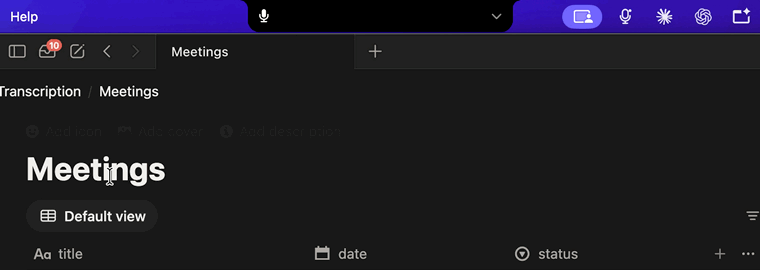
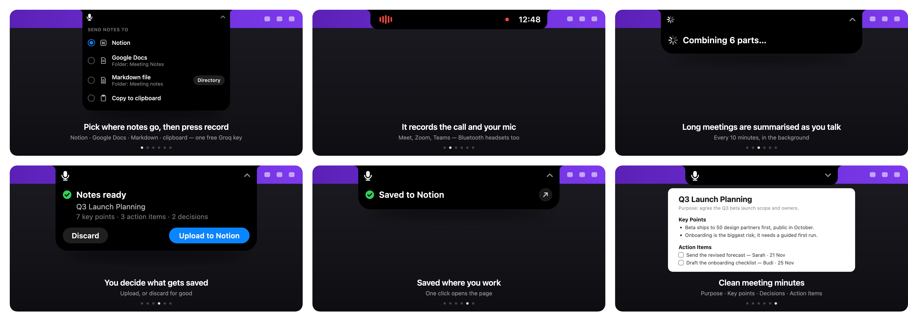

# Meeting Transcriber

**The simplest meeting notes app for macOS.** Press record in the notch, have your
meeting, and get clean minutes in Notion, Google Docs, Markdown or your clipboard.
One free Groq key, nothing to download, no setup beyond that.

<p align="center">
  
</p>

## Why it's different

- **Lives in the notch.** A black island under your menu bar: tap the mic to record,
  watch the waveform move with the conversation, hover it to stop.
- **Notes go where you already work.** Notion, Google Docs, a Markdown folder or the
  clipboard — pick once. Google and Notion connect with a sign-in, no exporting.
- **Minutes, not a transcript dump.** Every meeting becomes the same tidy page:
  Purpose · Key points · Decisions · Action items (checkboxes) · Open questions & risks,
  with an AI-written title so your pages aren't all called "Meeting".
- **You decide what gets saved.** When the notes are ready, choose **Upload** or
  **Discard** — discarding deletes the recording, transcript and notes for good.
- **Long meetings just work.** Every 10 minutes is transcribed and summarised in the
  background while you talk, so even a 2-hour meeting is ready seconds after you stop.
- **Records the whole call.** System audio (Meet, Teams, Zoom, Bluetooth headsets)
  plus your mic — no Screen Recording permission needed.
- **Light and free to run.** No 1 GB model to download; runs on any Apple-silicon Mac
  with macOS 14.2+. A free Groq key covers about 8 hours of meetings a day.
- **Mixed languages are fine** — English, Indonesian, Japanese and mixes.

## The journey

<p align="center">
  
</p>

1. **Pick where notes go, then press record** — the island under your notch.
2. **It records the call and your mic** — the waveform follows the voices.
3. **Long meetings are summarised as you talk** — 10 minutes at a time, in the background.
4. **Notes ready** — check the title and what's in it, then Upload or Discard.
5. **Saved** — one click opens the page.
6. **Clean minutes** — purpose, key points, decisions, action items you can tick off.

## Install

Download `MeetingTranscriber.dmg` from Releases, drag the app to Applications,
and follow **READ ME FIRST** inside the disk image (also in
[`DMG-README.txt`](DMG-README.txt)): first open, permissions, Groq key, Notion.

## Limits

With a **free Groq API key** you can process about **8 hours of meetings per day**
(Groq's free plan allows ~8 hours of transcription a day). Meeting length doesn't
matter — a 3-hour workshop works as well as several short calls — only the daily
total does. The limit resets on a rolling 24 hours.

Need more? Upgrade your key to Groq's paid Developer plan (roughly $0.04 per hour
of audio, plus a few cents per summary); the app needs no change.

## Build from source

Requires macOS 14.2+ and Xcode 15+ command-line tools.

```bash
scripts/package.sh
```

This builds `dist/Meeting Transcriber.app` and `dist/MeetingTranscriber.dmg`.
The app is ad-hoc signed, so macOS may ask for System Audio Recording and
Microphone permission again after each new build.

**Google Docs (optional):** create a "Desktop app" OAuth client in Google Cloud
(Drive API enabled, scope `drive.file` only), download its JSON to
`signing/google-oauth.json` (git-ignored), and `package.sh` bakes it into the app.
Without it the app builds fine and Google Docs reports it's unavailable.

## Privacy

Audio is recorded locally, sent only to Groq for transcription, and deleted once
your notes are saved. Your Groq key, Notion connection and Google sign-in are stored in this
Mac's app preferences, never in the app or this repository. Full policy:
[PRIVACY.md](PRIVACY.md).
