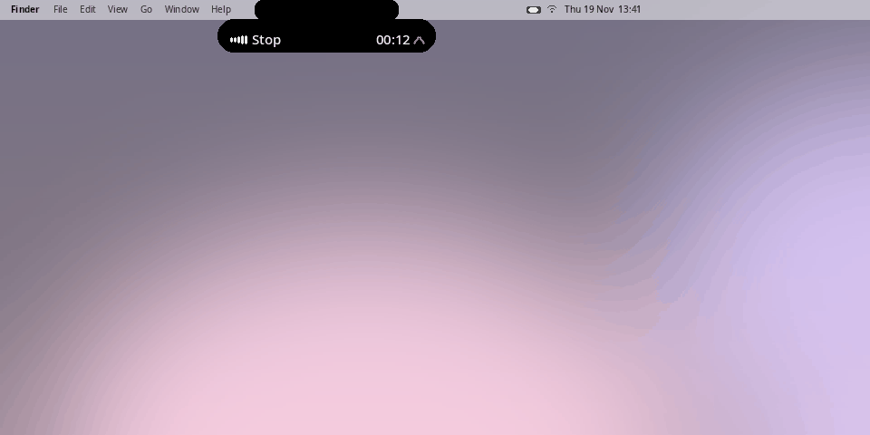

# Meeting Transcriber

**The simplest meeting notes app for macOS — now with Ask.** Press record in the notch, have your
meeting, and get clean minutes in Notion, Google Docs, Markdown or your clipboard. Then ask your
meeting anything — live, while you talk, or after: answers come from the transcript, with the exact
quotes and times they rest on, and terms the meeting only mentions are explained and labelled as
general knowledge. One free Groq key, nothing to download, no setup beyond that.

<p align="center">
  
</p>

*New in 1.5.0 — Ask is live during the call, summaries follow the amount of talk, and your Q&A goes out with the notes.*

## Why it's different

- **Ask your meeting anything, live.** Ask during the call or after it. Asking cuts the recording
  chunk, so answers cover the meeting up to the moment you ask — grounded in the transcript, with
  the verbatim quotes it rests on and their time in the meeting, so you can check it in one click.
  No more re-listening to find who said what, and no more guessing whether the AI made it up. Terms
  the meeting only mentions are explained and labelled as general knowledge, and your questions and
  answers travel out with the notes.
- **Lives in the notch.** A black island under your menu bar: tap the mic to record,
  watch the waveform move with the conversation, hover it to stop. When the card is open, a soft
  glow drifts along its bottom edge with the sound.
- **Notes go where you already work.** Notion, Google Docs, a Markdown folder or the
  clipboard — pick once. Google and Notion connect with a sign-in, no exporting.
- **Minutes, not a transcript dump.** Every meeting becomes the same tidy page:
  Purpose · Key points · Decisions · Action items (checkboxes) · Open questions & risks,
  with an AI-written title so your pages aren't all called "Meeting".
- **You decide what gets saved.** When the notes are ready, choose **Upload** or
  **Discard** — discarding deletes the recording, transcript and notes for good.
- **Long meetings just work.** As you talk, the meeting is transcribed and summarised in the
  background — a batch summarises once about 6,000 characters of transcript have built up, so
  silence adds nothing and busy talk summarises sooner — and even a 2-hour meeting is ready
  seconds after you stop.
- **Records the whole call.** System audio (Meet, Teams, Zoom, Bluetooth headsets)
  plus your mic — no Screen Recording permission needed.
- **Light and free to run.** No 1 GB model to download; runs on any Apple-silicon Mac
  with macOS 14.2+. A free Groq key covers about 8 hours of meetings a day.
- **Any language, kept as spoken.** Transcription uses Groq's Whisper, so every language
  Whisper supports (about 99 — English, Indonesian, Japanese, Spanish, Hindi, Arabic,
  Chinese, …) is detected automatically, mixed-language meetings included. The notes are
  written in the meeting's own language — never translated to English.

## The journey

<p align="center">
  
</p>

1. **Pick where notes go, then press record** — the island under your notch.
2. **It records the call and your mic** — the waveform follows the voices.
3. **Long meetings are summarised as you talk** — in the background, once enough has been said.
4. **Notes ready** — check the title and what's in it, then Upload or Discard.
5. **Saved** — one click opens the page.
6. **Clean minutes** — purpose, key points, decisions, action items you can tick off.
7. **Ask about it, live or after** — open Ask and question the meeting: what was decided, who owns what,
   what was actually said — answered from the transcript, with quotes and times.

The whole flow, from record to saved minutes:

<p align="center">
  
</p>

## Install

Download `MeetingTranscriber.dmg` from Releases, drag the app to Applications,
and follow **READ ME FIRST** inside the disk image (also in
[`DMG-README.txt`](DMG-README.txt)): first open, permissions, Groq key, Notion.

## Limits

With a **free Groq API key** you can process about **8 hours of meetings per day**
(Groq's free plan allows ~8 hours of transcription a day). Meeting length doesn't
matter — a 3-hour workshop works as well as several short calls — only the daily
total does. The limit resets on a rolling 24 hours.

Need more? Upgrade your key to Groq's paid Developer plan (roughly $0.04 per hour
of audio, plus a few cents per summary); the app needs no change.

## Build from source

Requires macOS 14.2+ and Xcode 15+ command-line tools.

```bash
scripts/package.sh
```

This builds `dist/Meeting Transcriber.app` and `dist/MeetingTranscriber.dmg`.
The app is ad-hoc signed, so macOS may ask for System Audio Recording and
Microphone permission again after each new build.

**Google Docs (optional):** create a "Desktop app" OAuth client in Google Cloud
(Drive API enabled, scope `drive.file` only), download its JSON to
`signing/google-oauth.json` (git-ignored), and `package.sh` bakes it into the app.
Without it the app builds fine and Google Docs reports it's unavailable.

## Privacy

Audio is recorded locally, sent only to Groq for transcription, and deleted once
your notes are saved. Your Groq key, Notion connection and Google sign-in are stored in this
Mac's app preferences, never in the app or this repository. Full policy:
[PRIVACY.md](PRIVACY.md).
